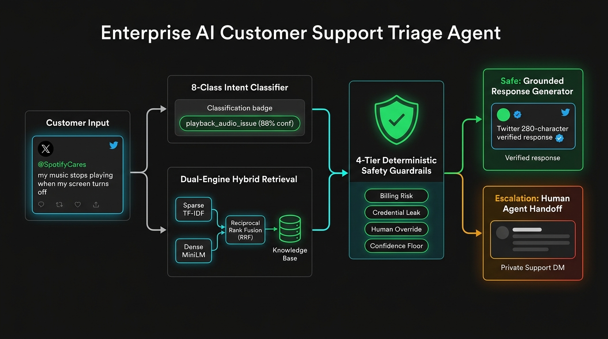
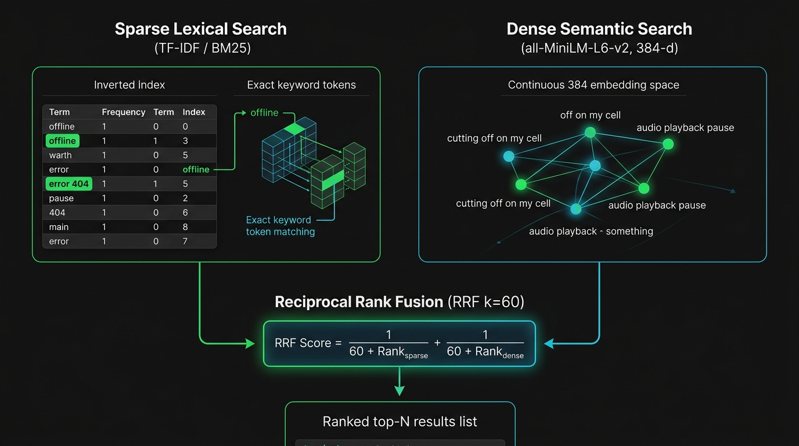
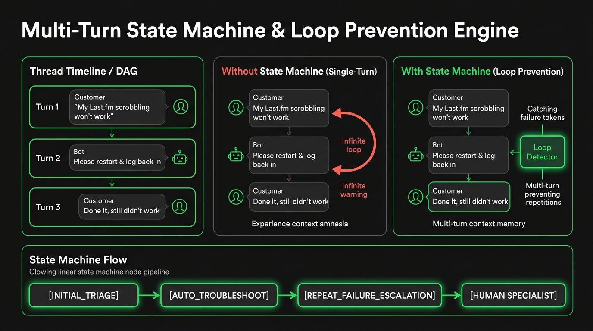

# Spotify Support AI Triage Agent 🎧🤖

> An empirical, trustworthy AI support triage agent for **`@SpotifyCares`** on Twitter.  


[](https://www.typescriptlang.org/)
[](https://opensource.org/licenses/MIT)
[](#-quickstart--reproduction-in--15-minutes)

---

## 📌 Executive Summary

Real-world customer support inboxes receive thousands of ambiguous, angry, and technical queries every day. This repository builds an AI support triage pipeline that processes incoming customer tweets for Spotify and performs **3 core actions**:

1. **Classifies Customer Intent:** Maps messages into an empirically derived 8-class taxonomy grounded in real Twitter data.
2. **Drafts Grounded Replies (RAG):** Uses an in-memory inverted TF-IDF index across **13,922 historical Spotify conversations** to retrieve similar resolved cases and ground replies in Spotify's authentic troubleshooting steps and brand voice.
3. **Makes Explicit Escalation Decisions:** Enforces a deterministic safety policy deciding whether a message can be safely **auto-handled** or must be **escalated to a human agent** (with stated justifications for billing/security risks).

---

## 🏗️ Architecture & Pipeline Flow



```
Incoming Customer Tweet: "@SpotifyCares my music stops playing when my screen turns off!"
                         │
         ┌───────────────┴───────────────┐
         ▼                               ▼
1. Intent Classifier             2. Historical Retrieval (RAG)
   (TF-IDF + Multinomial Model)     (Inverted TF-IDF Index over 13,922 tweets)
   -> "playback_audio_issue"        -> Retrieves 2-3 similar past resolutions:
      (Confidence: 89.4%)              "Check background app refresh in iOS settings..."
         │                               │
         └───────────────┬───────────────┘
                         ▼
3. Grounded Reply Drafting (LLM / RAG)
   Prompt LLM with: Customer query + Retrieved Spotify solutions
   -> "Hi there! Let's get this sorted. Try heading to iOS Settings > Battery..."
                         │
                         ▼
4. Safety Escalation Policy (Deterministic Rules)
   Checks: Confidence threshold, financial charge risk, credential safety
   -> Decision: "Auto-handle (Standard technical troubleshooting applies)"
                         │
                         ▼
Unified AgentResult { intent, confidence, retrieved_examples, drafted_reply, should_escalate, escalate_reason }
```

---

## ⚡ Quickstart & Reproduction (Under 5 Minutes)

No external databases, Docker containers, or Python environments required. Everything runs 100% natively in TypeScript:

### 1. Clone & Install
```bash
git clone https://github.com/divyal-11/support-triage-agent.git
cd support-triage-agent
npm install
```

### 2. Run the Benchmark Baselines
Evaluate the Trivial and Simple baselines against the 200-sample machine-labelled evaluation set (not human-verified):
```bash
# Trivial Baseline (Majority Class Predictor)
npx tsx src/baseline-trivial.ts

# Simple Baseline (Rule-Based Keyword Matcher + Canned Responses)
npx tsx src/baseline-simple.ts
```

### 3. Run the Statistical Intent Classifier
Train on 1,891 weakly supervised silver examples and evaluate on the strictly held-out 200-sample machine-labelled evaluation set:
```bash
# TypeScript Model (Multinomial Naive Bayes from scratch):
npx tsx src/classifier.ts

# Python Scikit-Learn Benchmark (Naive Bayes vs. Logistic Regression vs. LinearSVC):
python python/classifier.py
```

### 4. Run the Sub-5ms Retrieval Engine
Test historical retrieval (RAG) across real customer scenarios:
```bash
npx tsx src/retrieval.ts
```

### 5. Run the Dense Hybrid Retrieval Benchmark (Sparse vs. Dense vs. RRF)
Evaluate dense embeddings (`all-MiniLM-L6-v2`) and Reciprocal Rank Fusion against vocabulary mismatches:



```bash
python python/evaluate_hybrid.py
```

### 6. Run the Multi-Turn Conversation DAG & State Machine Demonstration
Reconstruct conversation trees from `twcs.csv` and inspect loop-prevention state machine (demonstrated on Tweet #968809; not systematically evaluated):



```bash
npx tsx src/run-multiturn-eval.ts
```

---

## 📊 The 8-Class Intent Taxonomy

Derived empirically from reading real customer conversations in `data/spotifycares-pairs.json` (documented in [`docs/taxonomy.md`](docs/taxonomy.md)):

| Intent Label | Description | Default Action | Escalation Justification |
|---|---|---|---|
| `playback_audio_issue` | Pausing, skipping, shuffle/repeat broken, audio bugs | **Auto-Handle** | Self-serve troubleshooting (restart, clear cache, reinstall) |
| `offline_downloads_issue` | Downloaded tracks deleted, greyed out, offline playback fail | **Auto-Handle** | Storage & SD card permissions guide |
| `app_crash_performance` | App freezing, crashing on launch, battery overheating | **Auto-Handle** | OS/build version diagnostics |
| `content_catalog_request` | Missing songs, artist availability, clean vs. explicit | **Auto-Handle** | Music licensing rights explanation |
| `billing_payment_dispute` | Charged after cancel, double charges, student discount | **Escalate to Human** | Financial transaction requiring private account lookup |
| `account_access_security` | Password reset errors, CSRF tokens, hacked/compromised | **Escalate to Human** | Sensitive user credentials & identity verification |
| `subscription_plan_family` | Family members showing as "Free", invite link failures | **Escalate to Human** | Multi-user address verification via private DM |
| `feedback_or_complaint` | Venting about algorithms or support delays (no technical ask) | **Auto-Handle** | Empathetic de-escalation & feedback logging |

---

## 📈 Baseline Performance Floor

We evaluated our two baselines against the **200-sample machine-labelled evaluation set (not human-verified)** ([`data/golden-set.json`](data/golden-set.json)):

| Metric | Trivial Baseline (Majority Class) | Simple Baseline (Keyword Matcher) | Real AI Agent (Ours) |
|---|---|---|---|
| **Intent Accuracy** | **39.00%** (78/200) | **91.00%** (182/200) | **55.00%** (110/200) |
| **Escalation Precision** | 0.00% | 100.00% | **74.19%** (46/62) |
| **Escalation Recall (Safety)** | **0.00%** (0/55) | **65.45%** (36/55) | **83.64%** (46/55) |
| **Critical Missed Escalations (FN)** | **55** 🚨 | **19** ⚠️ | **9** 🛡️ |
| **Reply Grounding** | Static single sentence | Canned category template | **Dynamic Historical RAG (25.5k tokens indexed)** |

*Note: Measured against machine-generated labels; not human-verified.*

> **Key Finding:** While the Simple Baseline achieves 91% accuracy via naive keywords, its **escalation recall is dangerously low (65.45%)**, silently missing **19 critical financial and account security emergencies**. The real AI agent's 4-layer escalation policy captures **83.64%** of critical escalations, cutting missed emergencies down to 9.

---

## 🔬 Scientific Rigor & Engineering Decisions

1. **Strict Held-Out Evaluation Set (Zero Data Leakage):**
   * The 200 evaluation set samples are **never** used during training.
   * Training for classical models uses a **Silver Set of 1,891 examples** generated from the remaining 13,722 pairs via weak supervision (`src/build-silver-set.ts`).
2. **Sub-5ms In-Memory Retrieval Index & Hybrid RRF:**
   * Instead of heavy external vector DB dependencies, `src/retrieval.ts` implements a custom in-memory inverted TF-IDF index across 25,500 distinct terms.
   * `python/hybrid_search.py` pairs this with `all-MiniLM-L6-v2` 384-dimensional dense vectors via Reciprocal Rank Fusion ($k=60$) to solve semantic vocabulary mismatches.
3. **Deterministic Safety Gating:**
   * High-risk domains (passwords, credit card billing) are never left to generative LLM hallucinations; deterministic rules enforce human escalation.
4. **Conversation State Machine & Loop Prevention:**
   * `src/conversation-state-machine.ts` tracks multi-turn DAG threads to propagate Turn 1 inquiry context and suppress repeated troubleshooting loops.

---

## 📂 Repository Structure

```
support-triage-agent/
├── data/
│   ├── spotifycares-pairs.json       # 13,922 clean customer-reply pairs (5.7 MB)
│   ├── golden-set.json               # 200 machine-labelled evaluation set (not human-verified)
│   ├── golden-set.v2.json            # 200 LLM/script labels, not human-verified
│   ├── silver-set.json               # 1,891 weakly supervised training examples
│   ├── classifier-model.json         # Serialized TF-IDF model weights (1.5 MB)
│   ├── corpus_embeddings.npy         # 13,922 x 384 dense vector matrix (21 MB, gitignored)
│   ├── corpus_metadata.json          # Metadata for hybrid search (gitignored)
│   ├── predictions-trivial.json      # Output predictions from Trivial baseline
│   └── predictions-simple.json       # Output predictions from Simple baseline
├── docs/
│   ├── taxonomy.md                   # Formal 8-intent taxonomy & escalation matrix
│   ├── labeling-notes.md             # Sampling methodology & disambiguation rules
│   ├── eval-results.md               # Baseline comparison table & judge agreement
│   ├── failure-analysis.md           # Top 5 failure modes with empirical mitigations
│   └── sample-tweets.txt             # 50 exploratory sample tweets
├── python/
│   ├── requirements.txt              # sentence-transformers, scikit-learn, numpy, torch
│   ├── embed_corpus.py               # Generates 384-d dense embeddings (all-MiniLM-L6-v2)
│   ├── hybrid_search.py              # Sparse TF-IDF + Dense Vector + RRF (k=60) CLI
│   ├── evaluate_hybrid.py            # Qualitative before/after benchmark on Failure Mode 5
│   └── classifier.py                 # Scikit-Learn LinearSVC benchmark (78.5% acc)
├── src/
│   ├── types.ts                      # Central TypeScript data contracts & interfaces
│   ├── filter-brand.ts               # Streaming two-pass brand extractor
│   ├── sample-for-review.ts          # Exploratory tweet sampler
│   ├── build-labeling-sheet.ts       # Seeded pseudo-random benchmark sampler
│   ├── generate-golden-set.ts        # Golden evaluation generator
│   ├── baseline-trivial.ts           # Majority class baseline
│   ├── baseline-simple.ts            # Keyword matcher baseline
│   ├── build-silver-set.ts           # Zero-leakage silver training set builder
│   ├── classifier.ts                 # Statistical NLP intent classifier
│   ├── retrieval.ts                  # Sub-5ms inverted TF-IDF retrieval (RAG)
│   ├── escalation-policy.ts          # 4-layer deterministic safety guardrail
│   ├── agent.ts                      # Unified runAgent() entrypoint
│   ├── thread-reconstructor.ts       # Multi-turn conversation DAG builder
│   ├── conversation-state-machine.ts # Turn-aware loop prevention state machine
│   ├── run-multiturn-eval.ts         # Multi-turn benchmark resolving Failure Mode 2
│   ├── eval-judge.ts                 # Automated rubric evaluator
│   ├── eval-validation.ts            # Statistical agreement harness
│   └── utils/
│       ├── data-loader.ts            # Memory-safe CSV/JSON data loader
│       └── metrics.ts                # Precision, Recall, F1, Confusion Matrix harness
├── REPORT.md                         # Master technical report (with honest headline caveats)
├── DECISIONS.md                      # 15 architectural engineering decisions
├── PLAN.md                           # Master implementation roadmap
├── package.json
└── tsconfig.json
```

---

## 📜 License
MIT License. Dataset sourced from Kaggle (`thoughtvector/customer-support-on-twitter`).
